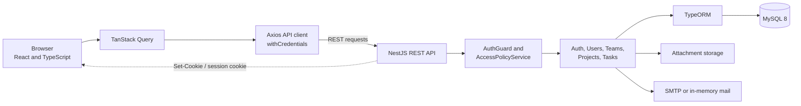
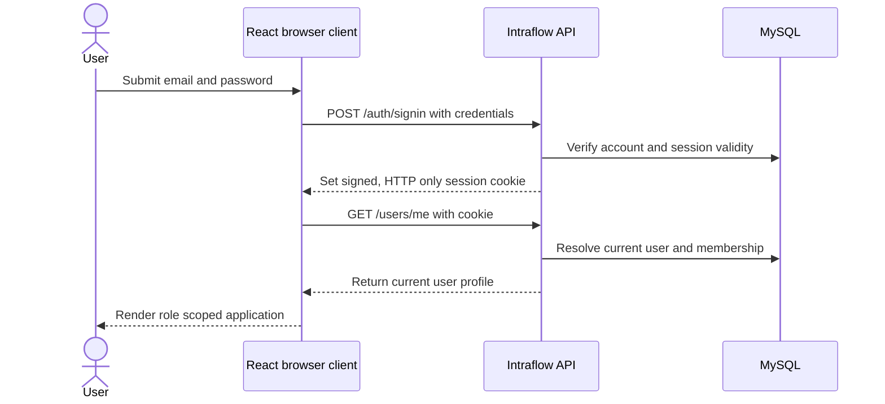
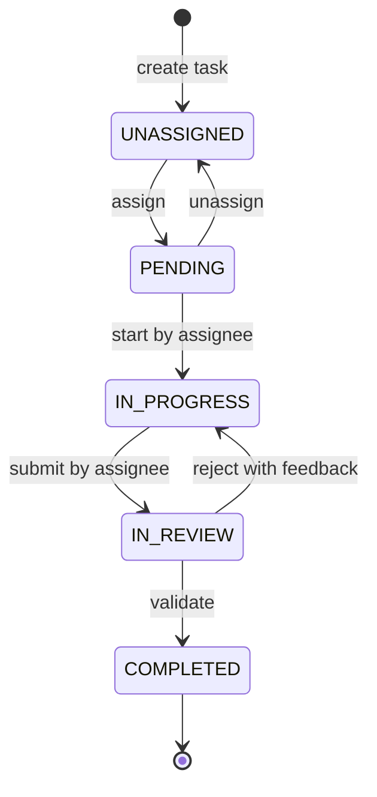
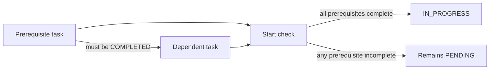
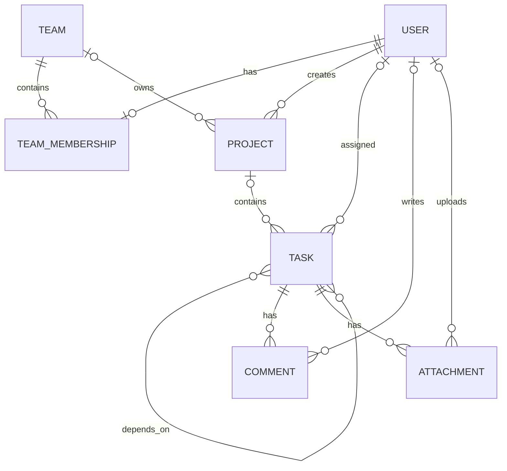

# Intraflow

Intraflow is a team based project and task management application. The React web client connects to a NestJS REST API and MySQL database. It supports team scoped projects, task assignment, a guarded Kanban lifecycle, dependencies, comments, and file attachments.

| Repository | Purpose |
| --- | --- |
| [intraflow](https://github.com/medaich/intraflow) | React web client |
| [intraflow-api](https://github.com/medaich/intraflow-api) | NestJS API and database services |

## Features

- Signed, HTTP only cookie sessions with session recovery on page load.
- Organization administrators, team moderators, and team members with separate permissions.
- Team and project management, task assignment, and a five state Kanban board.
- Task dependencies with cycle prevention and blocked task handling.
- Review comments, rejection feedback, and file attachments.
- Responsive project views for the board, task list, calendar, and progress summary.
- Centralized API errors and TanStack Query cache updates after mutations.

## Technology

| Area | Technology |
| --- | --- |
| Web client | React 19, TypeScript 5.8, Vite 7 |
| UI | Tailwind CSS 4, Radix UI, Lucide React |
| Server state | TanStack Query 5 |
| HTTP | Axios with browser credentials enabled |
| API | NestJS 11, TypeORM 0.3, Node.js 22 |
| Database | MySQL 8 |
| Package manager | pnpm 10.6.1 |

## Architecture

The browser calls the API through a shared Axios client. API authorization is enforced by the NestJS guards and policy service; the client only hides actions that the current user cannot perform. The API uses TypeORM for MySQL persistence and contains the business rules for teams, projects, tasks, authentication, comments, and attachments.



### Authentication and sessions

The API uses a signed, HTTP only session cookie. The frontend does not read an access token from the sign-in response or store one in browser storage. Its Axios client sends and receives cookies with `withCredentials: true`.



The browser origin must match the backend `CORS_ORIGIN` setting exactly, and the API must allow credentialed requests. For local development, use `http://localhost` consistently for both services. For deployment, use HTTPS and keep the frontend and API on the same site so the API's `SameSite=Lax` session cookie can be sent by the browser. Set `COOKIE_SECURE=true` for production HTTPS.

## Roles and permissions

There are two global roles. `ADMIN` is organization wide. `EMPLOYEE` accounts may hold at most one team membership with the team role `MODERATOR` or `MEMBER`.

| Action | Administrator | Team moderator | Team member |
| --- | --- | --- | --- |
| Manage teams and project records | Yes | No | No |
| Create tasks in a project | Yes | Own team projects | No |
| Assign tasks in a team project | To a non admin user of that project's team | To a non admin user of their own team | No |
| Assign a standalone or team less project task | To any non admin user | No | No |
| Start or submit a task | No | When assigned | When assigned |
| Validate or reject a task in review | Yes | Own team tasks | No |
| Assign an administrator as a task owner | Never | Never | Never |

Assignment options in the browser are filtered using the selected project's actual team. The API checks the same rules when the assignment request is received; client side filtering does not replace server authorization.

## Task lifecycle and Kanban

Task state is persisted by the API. New tasks start unassigned, and assigning a task moves it to `PENDING`. The backend accepts only these state transitions:



Starting a task also requires all of its dependencies to be `COMPLETED`. Rejection returns the task to `IN_PROGRESS` and records the reviewer's reason as a task comment. `COMPLETED` is terminal. The board offers task actions for keyboard and touch use; native drag and drop is an optional desktop interaction.

## Dependencies

Tasks can depend on other tasks in the same project. The API rejects dependency cycles and derives `isBlocked` and `blockedBy` from incomplete prerequisites. A blocked task remains in `PENDING`, but cannot be started until every prerequisite is complete.



## Teams, projects, and domain model

Projects may be associated with a team or left team less. Non administrators see projects within their own team. An employee can have at most one team membership; administrators are not team members. Tasks may belong to a project or be standalone. Dependencies connect tasks within one project.



The database model also includes account recovery and invitation records. Task records track their start, submission, and completion timestamps, alongside priority, status, assignee, and optional project.

Project statuses are `ACTIVE`, `ON_HOLD`, `COMPLETED`, and `ARCHIVED`. Administrators manage project records; a team moderator may mark an own-team project `COMPLETED` only after all its tasks are complete. Archived projects reject task operations, and projects containing tasks cannot be deleted.

### Frontend structure

```text
src/
  components/       Shared UI, task, team, and route-guard components
  contexts/         Authentication, theme, and sidebar state
  hooks/            Reusable client hooks
  lib/              Axios client and shared utilities
  pages/            Authentication and dashboard routes
  types/            API-aligned TypeScript domain types
  App.tsx           Route definitions
  main.tsx          React and TanStack Query providers
```

## API integration

The frontend uses the API's paginated `{ data, meta }` response for resource collections and updates the relevant TanStack Query caches after successful writes. Common API operations include:

| Capability | API routes used by the client |
| --- | --- |
| Authentication | `POST /auth/signup`, `/auth/signin`, `/auth/signout`, `/auth/forgot-password`, and `/auth/reset-password` |
| Profile and users | `GET /users/me`, `/users`, `/users/:userId`; `POST /users/me/email` and `/users/me/email/confirm` |
| Teams and projects | `/teams`, `/teams/:teamId`, `/projects`, and their detail or roster routes |
| Task collection | `/tasks`, `/tasks/my-tasks`, `/projects/:projectId/tasks` |
| Assignment | `POST /tasks/:taskId/assign`, `POST /tasks/:taskId/unassign` |
| Task workflow | `POST /tasks/my-tasks/:taskId/start`, `POST /tasks/my-tasks/:taskId/submit`, `POST /tasks/:taskId/validate`, `POST /tasks/:taskId/reject` |
| Collaboration | `/tasks/:taskId/comments`, `/tasks/:taskId/attachments`, and `/tasks/:taskId/dependencies` |

The API's interactive OpenAPI page is available at `http://localhost:3000/docs` when the backend is running. Its health endpoint is `http://localhost:3000/health`.

## Run locally

### Prerequisites

- Node.js 22
- pnpm 10.6.1
- Docker Desktop, or a local MySQL 8 instance
- The [Intraflow API repository](https://github.com/medaich/intraflow-api)

### Start the API and database

In a terminal, clone and configure the backend:

```bash
git clone https://github.com/medaich/intraflow-api.git
cd intraflow-api
pnpm install --frozen-lockfile
```

Copy `.env.example` to `.env` and configure a private `COOKIE_KEY` and database password for your local environment. The Docker Compose configuration exposes MySQL at `localhost:3308` and Mailpit at `localhost:8025`. Start those services, then run the API:

```bash
docker compose up -d mysql mailpit
pnpm run migration:run
pnpm run start:dev
```

Set `CORS_ORIGIN=http://localhost:5173` so it exactly matches the frontend's development origin. Set `APP_URL=http://localhost:5173` if email links should open in the local frontend. For local HTTP development, `COOKIE_SECURE=false` is expected.

### Start the frontend

In another terminal:

```bash
git clone https://github.com/medaich/intraflow.git
cd intraflow
corepack prepare pnpm@10.6.1 --activate
pnpm install --frozen-lockfile
```

Copy `.env.example` to `.env.local`. Set `VITE_API_URL` to the API base URL; the local default is `http://localhost:3000`. Then run:

```bash
pnpm dev
```

Vite serves the frontend at `http://localhost:5173` by default. `VITE_API_URL` is embedded in the frontend build, so configure it before building for another environment.

### Demo data

The backend's `pnpm run seed:demo` command creates local demo accounts, teams, a project, and six example tasks. It refuses to run when `NODE_ENV=production`. New accounts use development only credentials defined in the seeder; existing accounts are left unchanged.

| Demo task | Target state on fresh seed or reset | Scenario |
| --- | --- | --- |
| Base Architecture Setup | `COMPLETED` | Finished prerequisite |
| Database Indexing & Performance Tuning | `IN_PROGRESS` | Depends on the completed architecture task |
| Cache Layer Deployment | `PENDING` | Blocked by database indexing |
| Security Policy Review | `PENDING` | Assigned and ready to start |
| API Documentation Sync | `IN_REVIEW` | Submitted for review |
| Webhook Delivery Architecture | `IN_REVIEW` | Rejected with feedback, then resubmitted |

The seed creates these local development accounts when they do not already exist. Their initial passwords are assigned only when a new account is created; rerunning the seed does not change an existing account's password. These credentials are for a local demo database only.

| Account | Initial password | Role |
| --- | --- | --- |
| `admin@intraflow.dev` | `AdminPassword123!` | Administrator |
| `mod.alpha@intraflow.dev` | `DemoPassword123!` | Alpha Core moderator |
| `dev.alpha@intraflow.dev` | `DemoPassword123!` | Alpha Core member |
| `mod.beta@intraflow.dev` | `DemoPassword123!` | Beta Platform moderator |
| `dev.beta@intraflow.dev` | `DemoPassword123!` | Beta Platform member |

The seeder is repeatable and does not create duplicate active demo records. By default, it leaves existing task states and history untouched. To recreate only the six named tasks in the `Intraflow NextGen Platform` project, the backend requires both an explicit flag and confirmation token:

```bash
DEMO_SEED_RESET_CONFIRMATION=RESET_INTRAFLOW_DEMO_TASKS pnpm run seed:demo -- --reset-demo-tasks
```

In PowerShell, set `$env:DEMO_SEED_RESET_CONFIRMATION` to `RESET_INTRAFLOW_DEMO_TASKS`, run `pnpm run seed:demo -- --reset-demo-tasks`, then remove that environment variable. The reset is refused in production, if the named project is not assigned to `Alpha Core` or is archived, if a task outside the demo set depends on one of the demo tasks, or if the target tasks have file attachments. The reset removes the selected demo tasks and their task comments and dependency links before recreating the six scenarios; it does not reset other project, team, or user data. Run this only against a disposable development database.

## Commands and CI

| Command | Purpose |
| --- | --- |
| `pnpm dev` | Start the Vite development server |
| `pnpm run build` | Run TypeScript project compilation, then create production assets in `dist/` |
| `pnpm run lint` | Run ESLint across the frontend repository |
| `pnpm run preview` | Serve the production build locally |

GitHub Actions runs ESLint and the production build on pushes and pull requests targeting `main`. The workflow does not run an automated test suite.

## Deployment considerations

- Serve the API and frontend over HTTPS in production.
- Set the backend `CORS_ORIGIN` to the exact frontend origin and allow credentialed requests.
- Keep the frontend and API on the same site for the API's `SameSite=Lax` cookie. Use `COOKIE_SECURE=true` over HTTPS.
- Use a strong, private `COOKIE_KEY`; the backend validates a longer key for production.
- Set backend `APP_URL` to the public frontend origin for links in transactional email.
- Configure MySQL, SMTP, and persistent attachment storage for the deployment environment. The backend's default attachment storage is local disk.

This repository contains the frontend client; the API and database are maintained in the linked backend repository.
